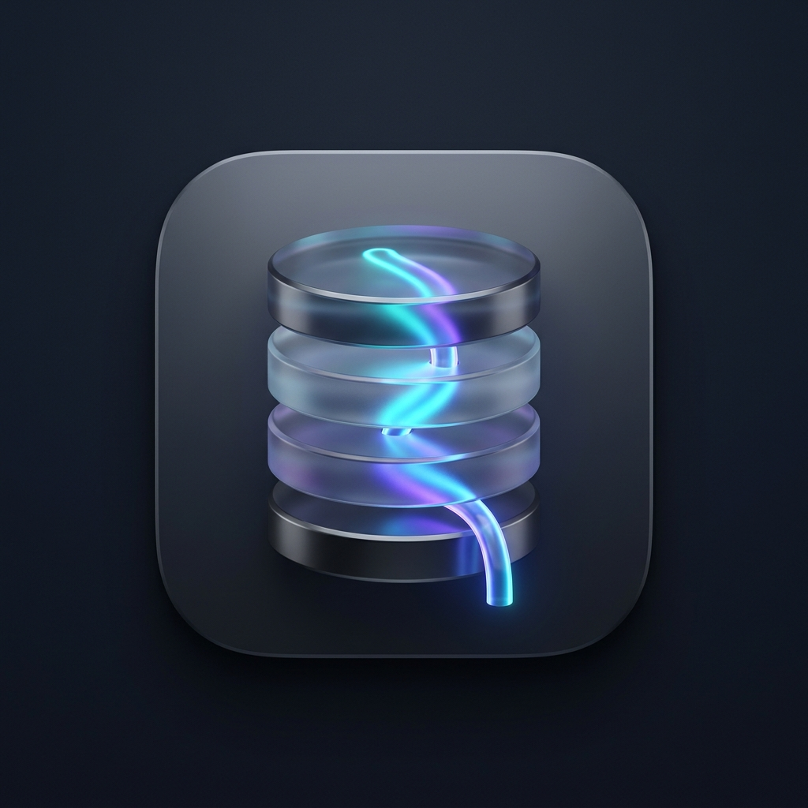
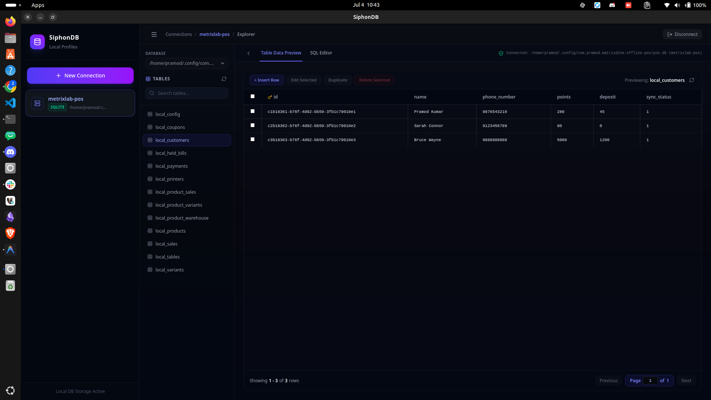
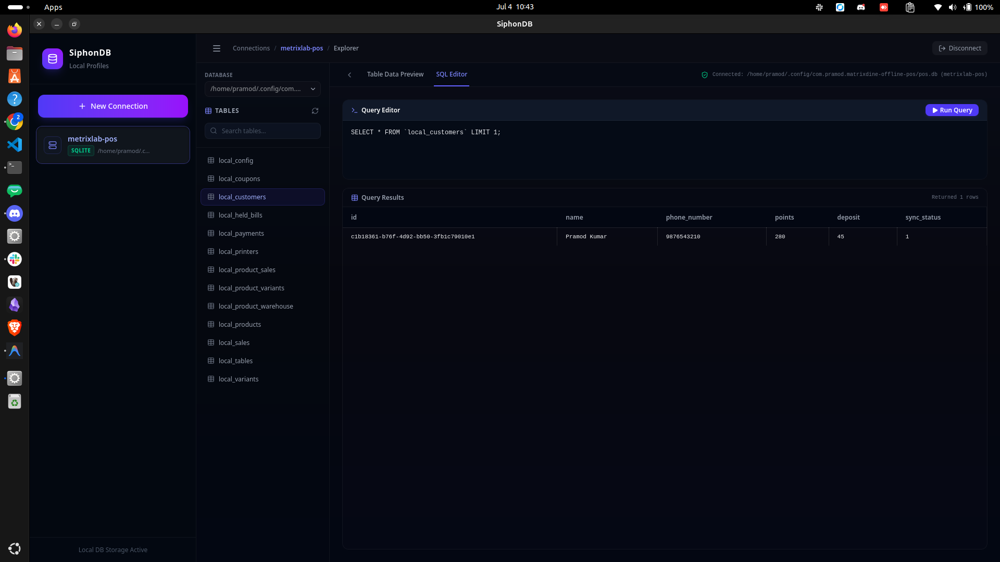
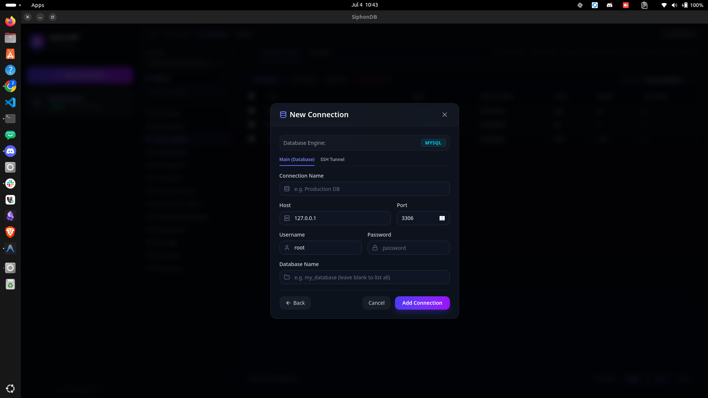
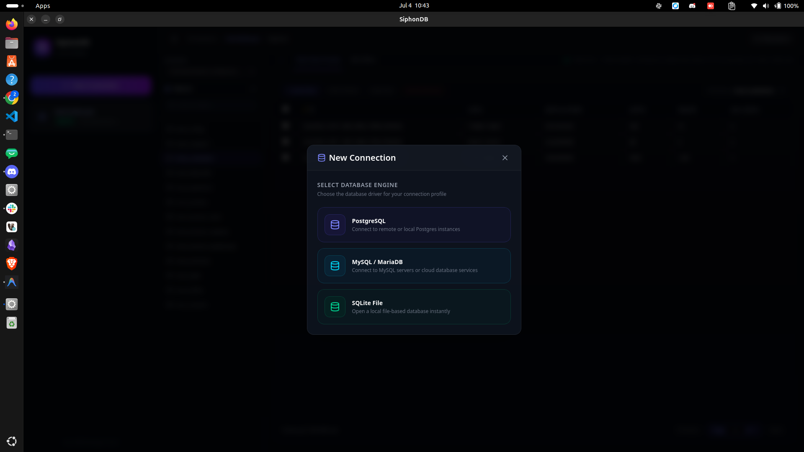

<div align="center">



# SiphonDB 🌀

**A blazingly fast, modern desktop database client & schema explorer built with Tauri v2, React 19, and Rust.**

[](https://tauri.app/)
[](https://react.dev/)
[](https://www.rust-lang.org/)
[](https://www.typescriptlang.org/)
[](https://tailwindcss.com/)
[](LICENSE)
[](https://github.com/Premod1/SiphonDB/labels/good%20first%20issue)

<p align="center">
  <a href="#-key-features">Key Features</a> •
  <a href="#-screenshots">Screenshots</a> •
  <a href="#-tech-stack">Tech Stack</a> •
  <a href="#-getting-started">Getting Started</a> •
  <a href="#-contributing">Contributing</a> •
  <a href="#-architecture--security">Architecture & Security</a>
</p>

</div>

---

## 🖥️ Screenshots

<table width="100%">
  <tr>
    <td width="50%" valign="top">
      <p align="center"><b>📊 Interactive Data Preview & Explorer</b></p>
      
    </td>
    <td width="50%" valign="top">
      <p align="center"><b>⚡ SQL Editor & Custom Query Runner</b></p>
      
    </td>
  </tr>
  <tr>
    <td width="50%" valign="top">
      <p align="center"><b>🔒 Connection Settings & SSH Tunneling</b></p>
      
    </td>
    <td width="50%" valign="top">
      <p align="center"><b>🔋 Database Driver Selection</b></p>
      
    </td>
  </tr>
</table>

---

## ✨ Key Features

- **🔋 Multi-Engine Support**: Seamlessly connect to and query **PostgreSQL**, **MySQL / MariaDB**, and local **SQLite** database files.
- **🔒 Built-in SSH Tunneling**: Securely bridge remote database hosts behind private bastions directly via Rust multi-threaded SSH (`ssh2`). Supports both **Password** and **Private Key** (`.pem`, `.key`) authentication.
- **📊 Interactive Data Grid**: Filter, sort, and paginate through records with zero UI freezes. Supports dynamic type casting for decimals, geometries, and binary fields.
- **🛠️ Direct Row CRUD Operations**: Insert new records, edit inline cells, duplicate rows, and batch-delete rows with automatic primary key detection.
- **⚡ SQL Editor with Autocomplete**: CodeMirror-based query editor with schema-aware autocompletion, execution history log, and saved query templates.
- **🗺️ Interactive ERD Schema Diagram**: Visual schema explorer with draggable table cards, smooth pan and zoom canvas, and SVG curves connecting foreign key relationships.
- **💾 Comprehensive Exporter**: Export selected tables or full schemas into **SQL dump**, **CSV**, or **JSON** with streaming chunk writes or fast native backups (`pg_dump` / `mysqldump`).
- **🛡️ AES-256-GCM Credential Encryption**: Sensitive database and SSH passwords are encrypted at rest using AES-256-GCM with a locally generated key file.
- **🎨 Modern Glassmorphic Dark UI**: Designed from the ground up with TailwindCSS v4, collapsible sidebars, micro-animations, and Lucide icons.

---

## 🛠 Tech Stack

| Layer | Technologies |
|---|---|
| **Frontend UI** | [React 19](https://react.dev/), [TypeScript](https://www.typescriptlang.org/), [TailwindCSS v4](https://tailwindcss.com/), [Vite](https://vitejs.dev/) |
| **SQL Editor** | [@uiw/react-codemirror](https://github.com/uiwjs/react-codemirror), [@codemirror/lang-sql](https://github.com/codemirror/lang-sql) |
| **Desktop Shell** | [Tauri v2](https://tauri.app/) (Rust 2021) |
| **Database Plugins** | [`tauri-plugin-sql`](https://github.com/tauri-apps/plugins-workspace/tree/v2/plugins/sql) (PostgreSQL, MySQL, SQLite) |
| **Networking & SSH** | Multi-threaded TCP bridge via Rust `ssh2` (vendored OpenSSL) |
| **Encryption** | Rust [`aes-gcm`](https://crates.io/crates/aes-gcm) (AES-256-GCM) with OS-restricted key permissions |

---

## 🚀 Getting Started

### Prerequisites

Ensure you have installed:
1. **Node.js** (v18.x or later) and `npm`
2. **Rust** toolchain:
   ```bash
   curl --proto '=https' --tlsv1.2 -sSf https://sh.rustup.rs | sh
   ```
3. Platform-specific build dependencies for Tauri v2:
   - **Linux (Ubuntu/Debian)**:
     ```bash
     sudo apt update && sudo apt install -y libwebkit2gtk-4.1-dev \
       build-essential curl wget file libxdo-dev libssl-dev libayatana-appindicator3-dev librsvg2-dev
     ```
   - **macOS**: `xcode-select --install`
   - **Windows**: Microsoft C++ Build Tools & WebView2

*(See [Tauri Prerequisites Documentation](https://tauri.app/start/prerequisites/) for other Linux distributions).*

### Installation & Development

1. Clone the repository:
   ```bash
   git clone https://github.com/Premod1/SiphonDB.git
   cd SiphonDB
   ```

2. Install dependencies:
   ```bash
   npm install
   ```

3. Launch in development mode with hot-reload:
   ```bash
   npm run tauri dev
   ```

### Building Standalone Executables

To package SiphonDB into an installer (`.deb`, `.AppImage`, `.msi`, `.dmg`, or standalone binary):
```bash
npm run tauri build
```

---

## 🤝 Contributing

We welcome contributions from everyone! Whether you want to fix a bug, improve performance, or propose new features:

1. Check out our beginner-friendly **[`good first issues`](https://github.com/Premod1/SiphonDB/labels/good%20first%20issue)** to get started.
2. Read the **[Contributing Guide (CONTRIBUTING.md)](CONTRIBUTING.md)** for branch conventions, coding guidelines, and PR procedures.
3. Open an issue or join existing discussions to share your thoughts!

---

## 🔒 Architecture & Security

### Secure Credential Storage
Credentials are encrypted locally using AES-256-GCM before writing to the internal database (`connections.db`). The encryption key is randomly generated and stored in the application's config directory (`siphondb.key`) with restricted file permissions (`0600` on Unix).

### Multi-Threaded SSH Bridge
When **SSH Tunneling** is enabled:
1. Tauri starts a background listener bound to `127.0.0.1:[random_port]`.
2. An authenticated SSH session is established with the remote server.
3. Incoming database connections from Tauri's SQL pool are mapped to direct-tcpip channels on the remote host.
4. Traffic is bidirectionally forwarded between local streams and remote channels.

---

## 📄 License

This project is open-source under the [MIT License](LICENSE).
